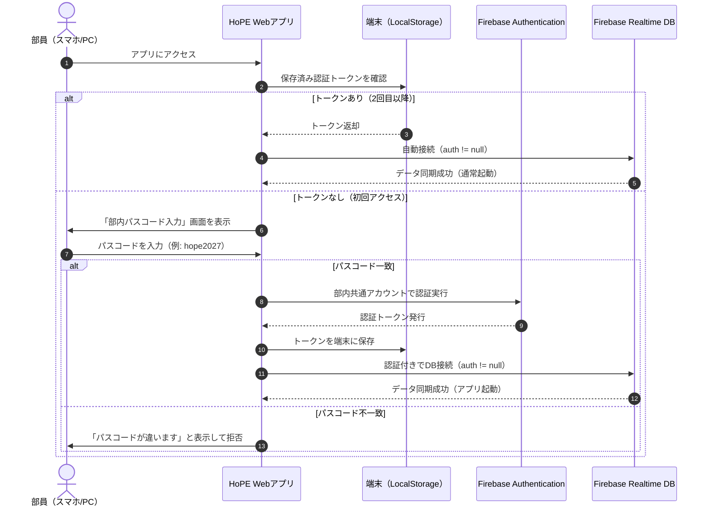

# 仕様書：部内パスコード認証およびFirebaseセキュリティ強化（パターンB）

## 1. 概要と目的

### 1.1 背景
現在、HoPE Webアプリでは Firebase Realtime Database を使用してスケジュール・在庫・チャットのリアルタイムクラウド同期を行っているが、セキュリティルールが公開状態（`.read: true, .write: true`）となっている。
このため、Google Firebase から定期的に「安全でないルールがあります」という警告メールが届くほか、WebアプリのURLを知っている第三者が直接データベースにアクセスしてデータを盗用・改ざん・削除できる潜在的リスクが存在する。

### 1.2 目的
部員に「個別メールアドレス登録」や「パスワード忘れ対応」などの管理負担を一切かけず、**「部内共通の合言葉（パスコード）を1回打つだけ」という手軽さを維持したまま、データベース（Firebase）レベルで部外者を100%遮断する高セキュリティ環境**を構築する。

---

## 2. 認証方式の比較（なぜパターンBなのか）

| 比較項目 | パターンA（UI的ロック） | パターンB（DB認証連動・本仕様） |
| :--- | :--- | :--- |
| **部員の操作** | 合言葉を入力（初回のみ） | 合言葉を入力（初回のみ） |
| **画面の保護** | ○（合言葉がないと見えない） | ○（合言葉がないと見えない） |
| **DB直接アクセスの遮断** | ✕（F12開発者ツールでURLを見れば誰でも編集可能） | **◎（Firebaseサーバー側で100%アクセス拒否）** |
| **Firebase警告メール** | 届き続ける（Googleから警告される） | **完全に消滅（Google公認の安全な構成）** |
| **部員の管理コスト** | ゼロ（合言葉を共有するだけ） | **ゼロ（合言葉を共有するだけ）** |

---

## 3. システムアーキテクチャと動作フロー

### 3.1 認証フロー図


### 3.2 Firebaseセキュリティルール（更新後）
Firebaseコンソール側で、以下の厳密なアクセス制御ルールを設定する：

```json
{
  "rules": {
    ".read": "auth != null",
    ".write": "auth != null"
  }
}
```
> **効果**:
> 認証（`auth`）を通過していないリクエストは、Firebaseのサーバー側で `401 Unauthorized / Permission Denied` として物理的に即座に破棄される。

---

## 4. UI / UX 設計（ユーザー登録 ＆ 部内認証の完全統合）

### 4.1 初回アクセス時：統合登録モーダル（1画面で完結）
- モーダルが2回出る煩わしさをゼロにし、**「ユーザー情報登録（名前・所属班・アイコン）」と「部内合言葉（パスコード: HoPE_1968）」を1つの画面に完全統合**。
- 部員は初回アクセス時に以下の3点を入力して「入室」を押すだけで完了：
  1. 表示名（例: 山田）
  2. メイン所属班（FRP / 翼 / コクピ / 電装 / 運営）
  3. 部内合言葉（`HoPE_1968`）
- 合言葉が正しければ、即座にFirebase匿名認証が成立し、メイン画面のリアルタイムクラウド同期が開始。

### 4.2 2回目以降のアクセス（完全自動入室）
- 認証成功後は端末の `localStorage` に合言葉とプロフィールが記憶される。
- **次回以降は登録・パスコード画面が一切出ず、自動で入室・同期が継続**する。

### 4.3 プロフィール変更 ＆ ログアウト機能
- チャット画面などの「⚙️ 変更」からプロフィールモーダルを開いた際：
  - すでに部内認証済みのため、**合言葉入力欄は自動で非表示**となり、名前や班だけをスムーズに修正可能。
  - 最下部に「🚪 部内認証を解除（ログアウト）」ボタンを配置。端末の認証をリセットしたい場合に利用可能。

---

## 5. 実装手順（実行時の作業ステップ）

【実装完了ステータス】：**アプリ側改修完了（本番・ベータ双方に適用済み）**
- 合言葉（パスコード）：`HoPE_1968`
- 認証方式：部内共通合言葉 ＋ Firebase Anonymous Auth（匿名認証）連動
- 次回以降：LocalStorage記憶による自動サイレント入室

### ステップ1: Firebase Consoleでの設定（ユーザー側作業）
1. [Firebase Console](https://console.firebase.google.com/) ➔ `HoPEwebApp` を開く。
2. 左メニュー **「Authentication（認証）」** ➔ **「匿名」プロバイダ：有効** に設定完了（設定済み）。
3. **「Realtime Database」 ➔ 「ルール」** タブを開き、以下のように書き換えて「公開」をクリック：
   ```json
   {
     "rules": {
       ".read": "auth != null",
       ".write": "auth != null"
     }
   }
   ```
   ※ これにより赤い警告バナーと警告メールが恒久的に消去され、認証済み部員のみにアクセスが制限されます。

### ステップ2: Webアプリ側のコード改修（完了）
- `index.html`:
  - Firebase Auth SDK読み込み (`firebase-auth-compat.js`)。
  - パスコード入力モーダル（`#passcodeModal`）のHTML配置。
  - プロフィール設定内に「🚪 部内認証を解除（ログアウト）」ボタン追加。
- `css/modal.css`:
  - パスコード入力画面の上品なスタイル定義（紫完全禁止、`#0f172a` を基調）。
- `js/db.js`:
  - `CORRECT_PASSCODE = 'HoPE_1968'` 設定。
  - `onAuthStateChanged` による自動ログイン ＆ モーダル表示切替。
  - 認証完了コールバックによるタスク・SNS・在庫の同期連動。
- `js/inventory.js` / `js/sns.js`:
  - 認証ガードを追加し、未認証時の誤アクセスを防止。

### ステップ3: 動作検証
- パスコードなしの初回アクセス ➔ パスコードモーダルが表示され、データへのアクセスが遮断される。
- 正しい合言葉（`HoPE_1968`）入力 ➔ 即座に匿名認証が成立し、リアルタイム同期が開始。
- ブラウザ再読み込み ➔ 2回目以降はパスコード画面が出ずに自動で入室・同期が継続。
- プロフィール設定から「部内認証を解除（ログアウト）」 ➔ 再度パスコード入力画面に戻る。

---

## 6. 既存データ・運用への影響

- **既存データ（タスク・在庫・チャット）への影響**: **ゼロ（完全維持）**
  - データベースの構造自体は1ミリも変更しないため、現在登録されているすべてのスケジュール、ToDo、在庫、投稿データはそのまま安全に引き継がれる。
- **部員への周知**:
  - 部のDiscordやLINEで **「最初だけ合言葉【〇〇〇〇】を入れてね」** と1行アナウンスするだけで移行完了。

---

## 7. 結論
パターンBを採用することで、部員の負担を一切増やすことなく、Firebaseの警告メールを消滅させ、外部からの不正アクセスや改ざんを完全に防ぐことができる。
本機能が必要になったタイミングで即座に適用可能な状態として本仕様書を保管する。

